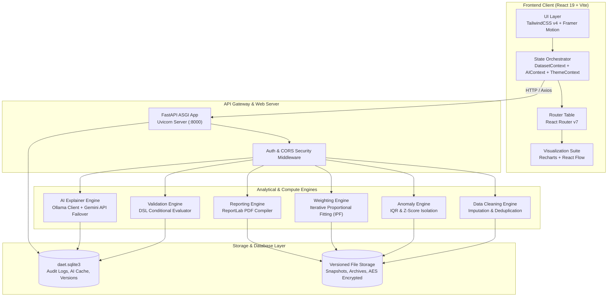
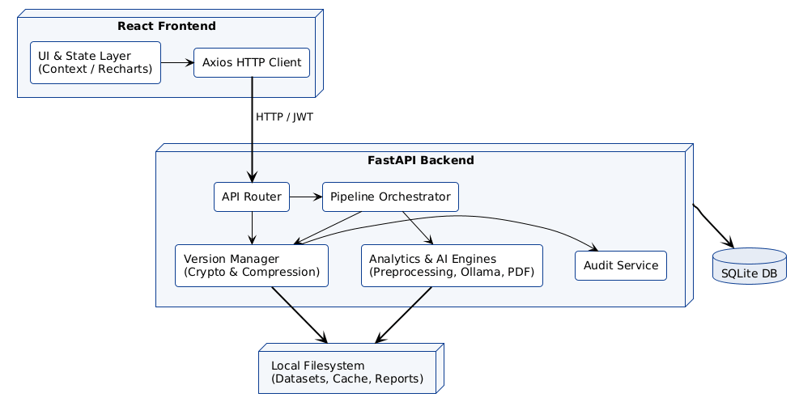
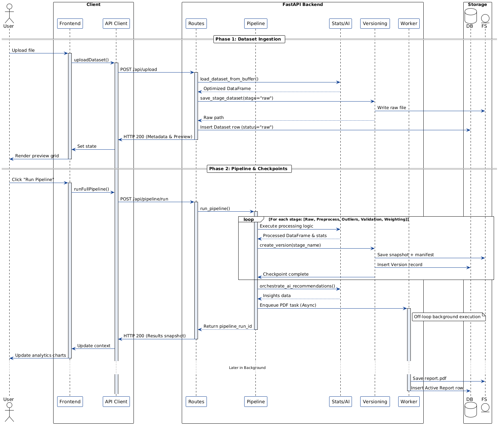
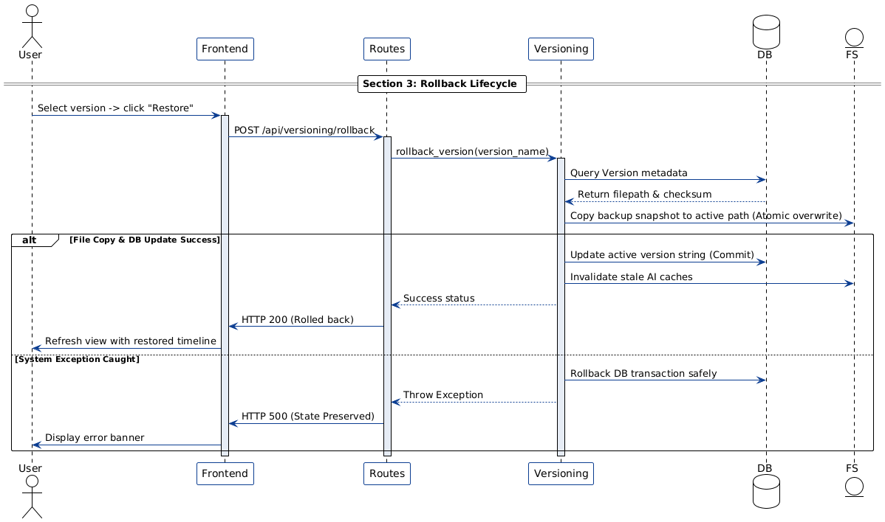
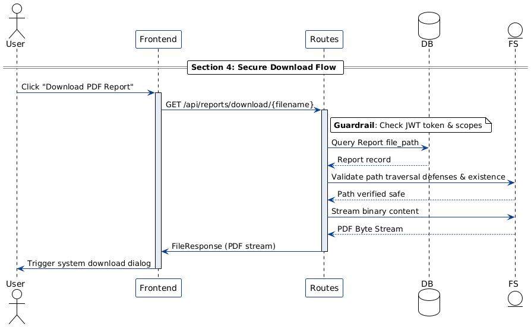
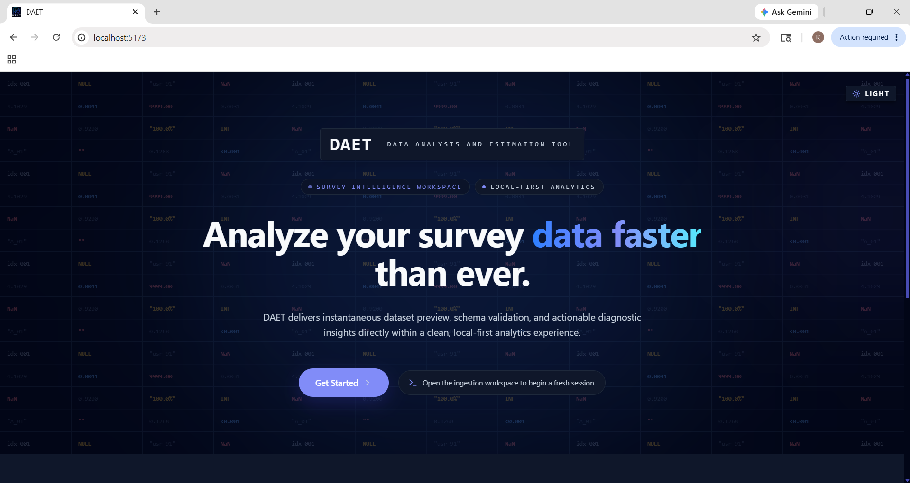
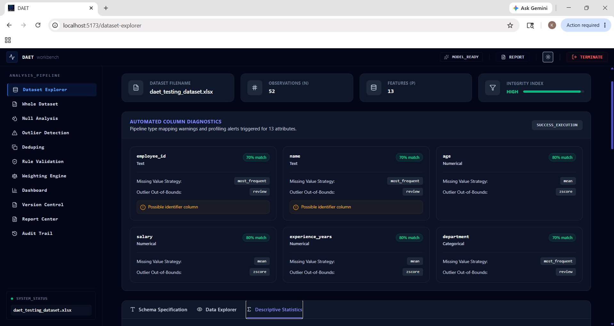
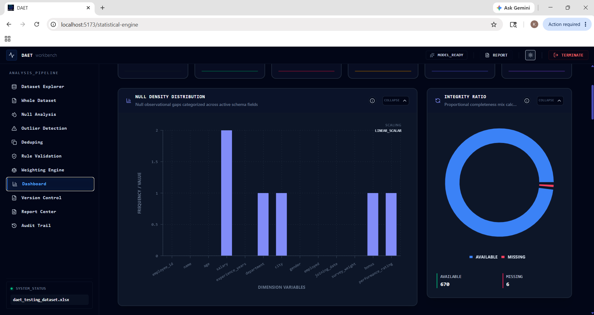
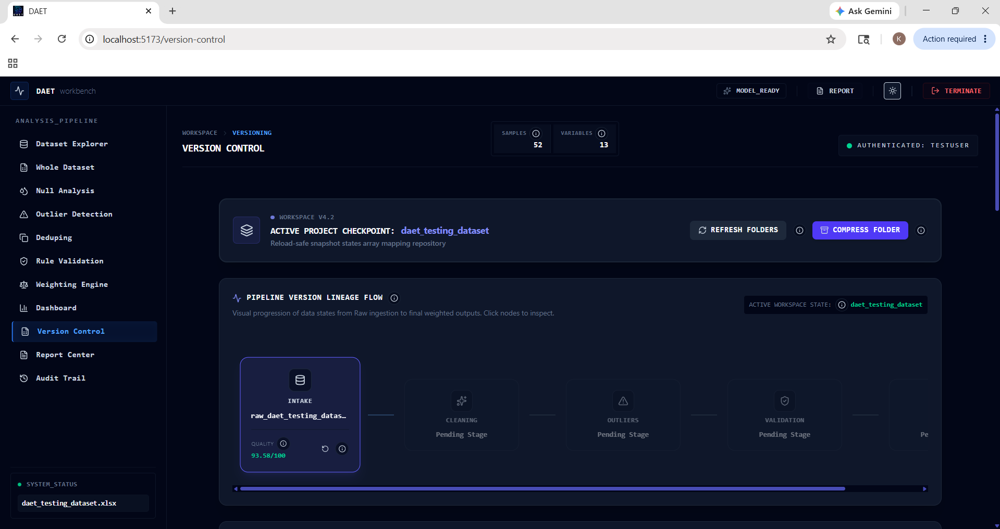
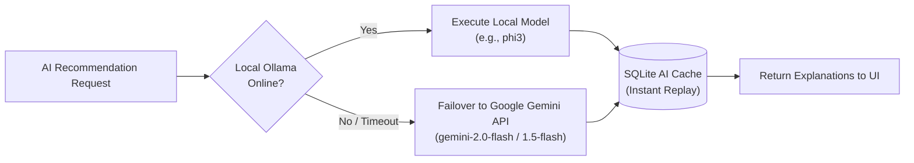

# DAET - AI-Augmented Survey Data Processing & Analytics Platform

[](https://react.dev/)
[](https://vitejs.dev/)
[](https://tailwindcss.com/)
[](https://fastapi.tiangolo.com/)
[](https://www.python.org/)
[](https://pandas.pydata.org/)
[](https://www.docker.com/)
[](./LICENSE)

**DAET** (Data Analysis & Estimation Tool) is an enterprise-grade full-stack platform engineered for ingesting, auditing, cleaning, and calibrating survey datasets. Powered by a high-throughput **FastAPI** backend and an interactive **React 19** frontend, DAET combines algorithmic data quality pipelines (vectorized imputation, IQR/Z-score anomaly detection, cross-field conditional DSL rules, Iterative Proportional Fitting demographic weighting) with **Dual-Provider Explainable AI** (Ollama + Google Gemini) and a **Git-like Version Control DAG** with single-click rollbacks.

---

## 📑 Table of Contents

- [Submodule Documentation](#-submodule-documentation)
- [Key Features](#-key-features)
- [System Architecture](#-system-architecture)
- [Workflow & Sequence Diagrams](#-workflow--sequence-diagrams)
- [Application Showcase](#-application-showcase)
- [Tech Stack Overview](#-tech-stack-overview)
- [Repository Structure](#-repository-structure)
- [Quick Start Guide](#-quick-start-guide)
  - [Prerequisites](#prerequisites)
  - [Backend Setup](#1-backend-setup)
  - [Frontend Setup](#2-frontend-setup)
- [AI Engine Configuration](#-ai-engine-configuration)
- [Docker & Production Deployment](#-docker--production-deployment)
- [Testing & Quality Assurance](#-testing--quality-assurance)
- [License](#-license)

---

## 📚 Submodule Documentation

Detailed implementation guides, API specifications, and directory breakdowns are maintained inside each submodule:

* 🖥️ **[Frontend Documentation](./frontend/README.md)**: React 19 architecture, Vite build pipeline, Tailwind v4 theme system, Recharts data visualization, React Flow version DAG, and Playwright E2E suites.
* ⚙️ **[Backend Documentation](./backend/README.md)**: FastAPI REST endpoints, Pydantic v2 schemas, IPF weighting engine, SQLite schema lineage, ReportLab PDF generator, and Pytest coverage.

---

## ⚡ Key Features

| Capability | Module | Technical Description |
| :--- | :--- | :--- |
| **High-Speed Ingestion & Profiling** | `IngestionPage` | Streaming CSV/XLSX intake, automatic Pandas dtype inference, macro KPI profiling, and memory footprint calculation. |
| **Dual-Mode Dataset Explorer** | `WholeDatasetPage` | Coordinate-based spreadsheet sheet matrix alongside searchable tabular data grid with live regex filtering and CSV export. |
| **Statistical Imputation** | `NullAnalysis` | Vectorized null substitution via Mean, Median, Mode, Constant fill, and Linear/Polynomial interpolation with before/after comparisons. |
| **Anomaly & Outlier Detection** | `AnomalyDetection` | Multi-method outlier isolation using Interquartile Range ($1.5 \times \text{IQR}$) and Z-Score ($\mu \pm 3\sigma$) thresholds with visual markers. |
| **Record Deduplication** | `Deduping` | Exact and subset duplicate row identification with flexible preservation strategies (Keep First, Keep Last, Drop All). |
| **Cross-Field Validation DSL** | `LogicValidation` | Rule-based engine supporting conditional logic (`if column X operator Y then enforce Z`), regex patterns, date-bounds, and numeric ranges. |
| **Demographic Weighting (IPF)** | `WeightingEngine` | Multi-dimensional Iterative Proportional Fitting (raking algorithm) calibrating sample distributions to target population marginals with convergence tolerance control. |
| **Dual-Provider Explainable AI** | `AIContext` / `ai_routes` | Local LLM inference (**Ollama** `phi3`) with automatic cloud fallback to **Google Gemini 2.0 Flash / 1.5 Flash**, cached via SQLite for instant replay. |
| **Git-like Version DAG & Rollback** | `VersionControl` | Immutable dataset snapshots on disk with directed acyclic graph (DAG) lineage visualization in React Flow, differential comparisons, and single-click state rollback. |
| **Audited PDF & JSON Reporting** | `ReportContainer` | Background asynchronous ReportLab PDF generation compiling quality scores, transformation logs, and compliance audit certificates. |
| **Enterprise Security & Encryption** | `backend/services` | AES-256 dataset encryption at rest, HMAC-SHA256 signed temporary download links, and database-to-disk reconciliation healing. |

---

## 🏗️ System Architecture



---

## 🔄 Workflow & Sequence Diagrams

### End-to-End Survey Processing Lifecycle


### Sequence Execution Pipelines




---

## 🖥️ Application Showcase

| Landing Portal & Dark Theme | Dataset Discovery & Profiling |
| :---: | :---: |
|  |  |
| **Analytics & Statistical Engine** | **Version Control & Lineage DAG** |
|  |  |

---

## 🛠️ Tech Stack Overview

### Frontend Architecture
* **Core:** React 19.2, Vite 8.0, Babel React Compiler
* **Styles:** TailwindCSS v4.3, Custom HSL Theme Variable Architecture
* **Routing:** React Router v7
* **State Management:** Scoped React Context Providers (`DatasetContext`, `AIContext`, `AuthContext`, `ThemeContext`, `VersionContext`) & Zustand
* **Visualization:** Recharts 3.8 (Histograms, Scatter, Boxplots, Correlation Heatmaps), React Flow 11.11 (DAG lineage graphs)
* **Animation & Icons:** Framer Motion 12.38, Lucide React 1.14

### Backend Architecture
* **Framework:** FastAPI 0.110+, Uvicorn ASGI
* **Data Processing:** Pandas 2.2+, NumPy, SciPy (IPF raking & matrix math)
* **Database & ORM:** SQLite 3, SQLAlchemy 2.0
* **AI & LLM Services:** Local Ollama (`phi3`) client with cloud failover to **Google Gemini 2.0 Flash / 1.5 Flash**
* **Reporting:** ReportLab 4.0+ (automated PDF generation), Pillow
* **Security & Cryptography:** Pyca/Cryptography (AES-256 file encryption at rest, HMAC signed tokens, SHA-256 data integrity hashing)
* **Containerization:** Multi-stage Dockerfile for containerized deployment

---

## 📁 Repository Structure

```
DAET/
├── backend/                        # FastAPI Python ASGI Application
│   ├── core/                       # App initialization, configs, database & exceptions
│   ├── models/                     # SQLAlchemy relational schemas (Audit, Versions, Projects, AI Cache)
│   ├── routes/                     # Domain route handlers (upload, cleaning, statistics, AI, etc.)
│   ├── schemas/                    # Pydantic v2 validation DTOs and request/response models
│   ├── services/                   # Core business logic engines:
│   │   ├── ai/                     # Ollama client, Gemini fallback, prompt templates & cache
│   │   ├── archive/                # Dataset snapshot archiving & encryption
│   │   ├── reporting/              # Asynchronous PDF compilation engine
│   │   ├── statistics/             # IPF iterative raking & variance estimation
│   │   ├── storage/                # Disk storage layout & snapshot management
│   │   ├── validation/             # DSL rule parser & conditional evaluators
│   │   └── versioning/             # Git-like DAG version control & rollback
│   ├── utils/                      # Vectorized pandas helpers, hashing & logging decorators
│   ├── tests/                      # Pytest unit, integration, and security test suites
│   ├── Dockerfile                  # Container build recipe
│   ├── requirements.txt            # Python dependencies
│   └── main.py                     # Backend application entry point
│
├── frontend/                       # React 19 + Vite Frontend Application
│   ├── src/
│   │   ├── assets/                 # Brand assets and styling
│   │   ├── components/             # Reusable UI component modules:
│   │   │   ├── auth/               # Modal authentication dialogs
│   │   │   ├── charts/             # Recharts wrappers (Histograms, Heatmaps, Boxplots, DAGs)
│   │   │   ├── cleaning/           # Cleaning wizards (Imputation, Outliers, Validation, Weighting)
│   │   │   ├── common/             # Micro-components (AIInsightCard, StatusBadge, SearchInput)
│   │   │   ├── complete_dataset/   # Full datasheet spreadsheet viewer
│   │   │   ├── dataset/            # Attribute profiler, column diagnostics & KPI cards
│   │   │   └── UI/                 # Core chrome (Navbar, Sidebar, Loader, DataGridBackground)
│   │   ├── context/                # React Context Providers for global state synchronization
│   │   ├── hooks/                  # Domain hooks (useDataset, useAI, useValidation, useVersioning)
│   │   ├── pages/                  # Route-level views (home, ingestion, data, cleaning, versioning)
│   │   ├── services/api/           # Centralized Axios client and domain API modules
│   │   ├── utils/                  # Report generators, tooltip content, session restoration
│   │   ├── allroutes.jsx           # Enterprise React Router table
│   │   ├── App.jsx                 # App root component
│   │   └── index.css               # Design system & dark/light CSS variables
│   ├── package.json                # Frontend dependencies & build scripts
│   └── vite.config.js              # Vite compiler configuration
│
├── documents/                      # Architectural diagrams, sequence flows & UI screenshots
├── docker-compose.yml              # Multi-container orchestration specification
├── LICENSE                         # MIT Open Source License
└── README.md                       # Project master documentation
```

---

## 🚀 Quick Start Guide

### Prerequisites
* **Python**: `3.10` or higher (`3.12` recommended)
* **Node.js**: `v18.0.0` or higher (`v20+` recommended)
* **npm**: `v9.0.0` or higher

### 1. Backend Setup

```bash
# 1. Clone repository & enter project directory
git clone https://github.com/varunchandra10/data_analysis_estimation_tool.git
cd data_analysis_estimation_tool

# 2. Navigate to backend
cd backend

# 3. Create and activate a Python virtual environment
# Windows (PowerShell):
python -m venv venv
.\venv\Scripts\Activate.ps1

# macOS / Linux:
python3 -m venv venv
source venv/bin/activate

# 4. Install backend dependencies
pip install -r requirements.txt

# 5. Start the FastAPI development server
uvicorn main:app --reload --port 8000
```
* Interactive API Documentation will be live at: **`http://localhost:8000/docs`**

### 2. Frontend Setup

In a new terminal window:
```bash
# 1. Navigate to frontend directory
cd frontend

# 2. Install dependencies
npm install

# 3. Launch Vite development server
npm run dev
```
* The application interface will be live at: **`http://localhost:5173`**

---

## 🤖 AI Engine Configuration

DAET provides a resilient **Dual-Provider Architecture** for generating automated data cleaning suggestions and natural language explanations:



### Option A: Local Ollama (Offline / Private)
1. Install [Ollama](https://ollama.ai/).
2. Pull and start your preferred model:
   ```bash
   ollama serve
   ollama run phi3
   ```

### Option B: Google Gemini API (Cloud Fallback / Production)
1. Create a `.env` file in the project root:
   ```env
   GEMINI_API_KEY=your_gemini_api_key_here
   ```
2. When local Ollama is unreachable, DAET will automatically route analytical queries to Gemini 2.0 Flash.

---

## 🐳 Docker & Production Deployment

### Local Docker Build & Run
DAET includes a production-grade Dockerfile for running containerized instances:

```bash
# Build the Docker image from repository root
docker build -t daet-backend -f backend/Dockerfile backend

# Run the container locally with environment file
docker run --rm -p 8000:8000 --env-file .env daet-backend
```

### Deploying to Render
1. Create a **Web Service** on [Render](https://render.com/).
2. Connect your repository and select **Docker** environment (Render detects `backend/Dockerfile`).
3. In the **Environment Variables** dashboard tab, add:
   - `GEMINI_API_KEY`: *Your Google Gemini API token*
   - `PORT`: `8000`

---

## 🧪 Testing & Quality Assurance

### Backend Unit & Integration Tests (Pytest)
```bash
cd backend
pytest -v
```
*Suites validate IPF convergence, Pydantic schemas, AES encryption roundtrips, and authentication integrity.*

### Frontend Production Build & Code Quality
```bash
cd frontend
# Run ESLint validation
npm run lint

# Compile production bundle
npm run build
```

---

## 📄 License

This project is licensed under the terms of the [MIT License](./LICENSE).
