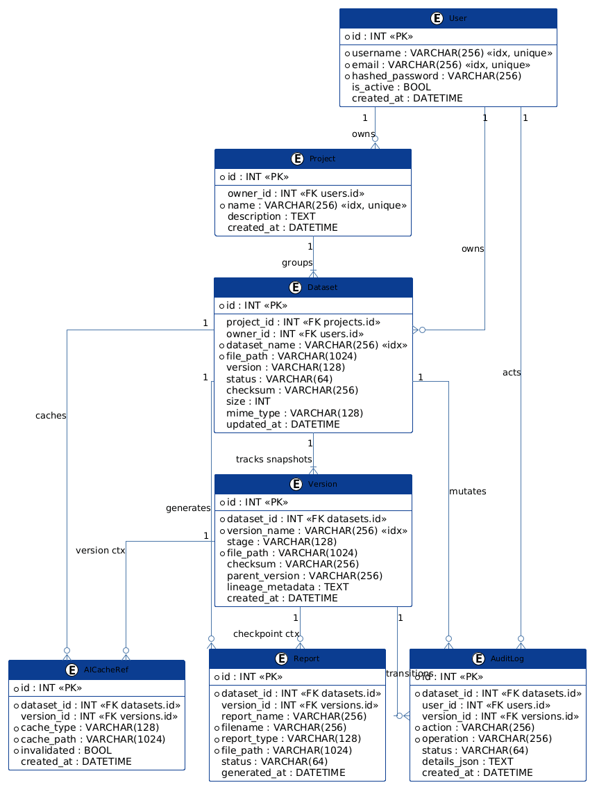

# DAET Backend (Data Analysis & Estimation Tool)

[](https://fastapi.tiangolo.com/)
[](https://www.python.org/)
[](https://pandas.pydata.org/)
[](https://docs.pydantic.dev/)
[](https://www.sqlite.org/)
[](https://pytest.org/)

DAET Backend is an asynchronous, high-throughput analytical service powered by **FastAPI**, **Pandas**, and **SciPy**. It provides mathematical computing engines for survey data cleaning, missing value imputation, cross-field conditional rule validation, Iterative Proportional Fitting (IPF) demographic weighting, dual-provider explainable AI (Ollama + Google Gemini), and cryptographically secured Git-like dataset versioning.

---

## 📑 Table of Contents

- [Core Analytical Capabilities](#-core-analytical-capabilities)
- [Tech Stack Overview](#-tech-stack-overview)
- [Directory Architecture](#-directory-architecture)
- [Comprehensive API Reference](#-comprehensive-api-reference)
- [Deep Dive: Computational Engines](#-deep-dive-computational-engines)
  - [1. Iterative Proportional Fitting (IPF Raking)](#1-iterative-proportional-fitting-ipf-raking)
  - [2. Dual-Provider AI Architecture](#2-dual-provider-ai-architecture)
  - [3. Git-like Version DAG & Rollback](#3-git-like-version-dag--rollback)
  - [4. Cross-Field Validation DSL](#4-cross-field-validation-dsl)
- [Database Schema & ER Diagram](#-database-schema--er-diagram)
- [Quick Start Guide](#-quick-start-guide)
  - [Prerequisites](#prerequisites)
  - [Environment Setup](#environment-setup)
- [Docker & Containerized Deployment](#-docker--containerized-deployment)
- [Testing & Validation](#-testing--validation)

---

## ⚡ Core Analytical Capabilities

| Capability | Module | Implementation Highlights |
| :--- | :--- | :--- |
| **Ingestion & Streaming Profiling** | `routes/upload_routes.py` | Streaming multipart upload for CSV and Excel files, chunked dtype profiling, memory footprint tracking, and initial snapshot registration. |
| **Vectorized Imputation** | `services/cleaning_service.py` | High-speed Pandas vectorized imputation supporting Mean, Median, Mode, Constant fill, and Linear/Polynomial interpolation. |
| **Outlier Detection & Capping** | `services/cleaning_service.py` | Interquartile Range ($1.5 \times \text{IQR}$) and Z-Score ($\mu \pm 3\sigma$) statistical filters with Winsorization capping support. |
| **Record Deduplication** | `services/cleaning_service.py` | Multi-column exact and subset duplicate detection with configurable resolution policies (*Keep First*, *Keep Last*, *Drop All*). |
| **Conditional Validation DSL** | `services/validation/` | Custom expression evaluator parsing cross-field conditions, regex patterns, datetime intervals, and domain constraints. |
| **Demographic Weighting (IPF)** | `services/statistics/ipf_engine.py` | Multi-dimensional Iterative Proportional Fitting (raking algorithm) for calibrating sample marginal distributions to census targets. |
| **Dual-Provider Explainable AI** | `services/ai/` | Automated natural language reasoning: local **Ollama** (`phi3`) client with instant fallback to **Google Gemini 2.0 Flash / 1.5 Flash**, backed by an SQLite cache. |
| **Audited Asynchronous Reports** | `services/reporting/engine.py` | Background task compiling high-fidelity PDF analytics summaries using ReportLab. |
| **Security & Cryptography** | `services/archive/` & `utils/` | AES-256 dataset encryption at rest, HMAC-SHA256 signed temporary download tokens, and reconciliation scan healing. |

---

## 🛠️ Tech Stack Overview

| Category | Technology | Notes |
| :--- | :--- | :--- |
| **ASGI Framework** | FastAPI 0.110+ | High-throughput async routing, dependency injection, and OpenAPI documentation. |
| **Server Engine** | Uvicorn | Lightning-fast ASGI production web server. |
| **Data Manipulation** | Pandas 2.2+, NumPy | Vectorized dataframe computations, chunked transformations, and matrix operations. |
| **Statistical Algorithms**| SciPy, Statsmodels | Normal distribution calculations, IPF iterative raking, and variance estimators. |
| **Database & ORM** | SQLite 3, SQLAlchemy 2.0 | Lightweight relational persistence for audit logs, version DAGs, and AI cache. |
| **Schema Validation** | Pydantic v2 | Strictly typed request/response Data Transfer Objects (DTOs). |
| **AI / LLMs** | Ollama (`phi3`) & Google Gemini | Dual-provider architecture: local LLM inference with Gemini 2.0 Flash cloud failover. |
| **Document Generation**| ReportLab 4.0+, Pillow | Programmatic compilation of enterprise PDF analytics reports. |
| **Cryptography** | Pyca/Cryptography | AES-256 CBC/GCM encryption, HMAC signing, and SHA-256 data integrity checksums. |
| **Containerization** | Docker | Reproducible container environment for local development and Render deployment. |
| **Testing** | Pytest, Pytest-Asyncio | Automated analytical validation, API integration, and security test suites. |

---

## 📁 Directory Architecture

```
backend/
├── core/                           # Application core infrastructure
│   ├── app_init.py                 # FastAPI lifecycle, CORS, and middleware setup
│   ├── config.py                   # Pydantic Settings, environment variables, directory paths
│   ├── database.py                 # SQLAlchemy engine, session maker, and DB initialization
│   └── exceptions.py               # Custom API exception classes and HTTP handlers
│
├── models/                         # SQLAlchemy 2.0 Relational Models
│   ├── ai_cache_model.py           # SQLite cache for generated AI recommendations & explanations
│   ├── audit_log_model.py          # Chronological log of pipeline transformations
│   ├── dataset_model.py            # Primary dataset registry and metadata records
│   ├── project_model.py            # Multi-project organization records
│   ├── report_model.py             # Asynchronous PDF report job metadata
│   ├── user_model.py               # User authentication records and credentials
│   └── version_model.py            # Dataset version lineage records and parent-child DAG edges
│
├── routes/                         # FastAPI Domain Route Handlers
│   ├── ai_routes.py                # AI recommendations and natural language explanations
│   ├── auth_routes.py              # User registration, JWT login, and session tokens
│   ├── cleaning_routes.py          # Missing value imputation endpoints
│   ├── duplicate_routes.py         # Record deduplication endpoints
│   ├── logs_routes.py              # Audit trail log queries
│   ├── outlier_routes.py           # Outlier detection and filter application
│   ├── pipeline_routes.py          # Full dataset preview and pipeline status
│   ├── report_routes.py            # PDF report job queue, polling, and downloads
│   ├── statistics_routes.py        # Descriptive statistics, correlations, and IPF weighting
│   ├── upload_routes.py            # CSV/XLSX streaming upload and schema discovery
│   ├── validation_routes.py        # Rule suggestion and DSL execution
│   └── versioning_routes.py        # Version DAG querying, diffing, rollback, and encryption
│
├── schemas/                        # Pydantic v2 DTOs (Data Transfer Objects)
│   ├── ai_schema.py                # Request/response models for AI prompts and recommendations
│   ├── auth_schema.py              # User credentials, JWT tokens, and profile responses
│   ├── cleaning_schema.py          # Imputation parameters and cleaning responses
│   ├── common.py                   # Standardized BaseResponse and pagination DTOs
│   ├── pipeline_schema.py          # Pipeline progress models
│   ├── upload_schema.py            # Upload responses and schema metadata models
│   ├── validation_schema.py        # DSL rule definitions and violation models
│   ├── versioning_schema.py        # Version manifests, rollback payloads, and tokens
│   └── weighting_schema.py         # IPF demographic targets and weighting responses
│
├── services/                       # Core Analytical & Business Logic Engines
│   ├── ai/                         # Dual-provider AI subsystem:
│   │   ├── cache_engine.py         # SQLite caching for AI outputs
│   │   ├── explanation_engine.py   # Explanation orchestrator with fallback logic
│   │   ├── ollama_client.py        # Local Ollama REST client
│   │   ├── prompt_builder.py       # Domain-engineered prompt templates
│   │   └── recommendation_engine.py# Automated cleaning recommendation rules
│   ├── archive/                    # Dataset archiving, compression, and AES encryption
│   ├── reporting/                  # Asynchronous ReportLab PDF compiler
│   ├── statistics/                 # Statistical and demographic weighting engines:
│   │   ├── ci_utils.py             # Confidence interval calculations
│   │   ├── ipf_engine.py           # Iterative Proportional Fitting (raking algorithm)
│   │   ├── variance_utils.py       # Weighted variance estimation
│   │   └── weighting_engine.py     # End-to-end demographic calibration pipeline
│   ├── storage/                    # Disk layout and dataset persistence
│   ├── validation/                 # Cross-field validation engine:
│   │   ├── dispatcher.py           # Rule evaluator routing
│   │   ├── engine.py               # Validation execution engine
│   │   ├── evaluators.py           # DSL condition evaluators (range, regex, conditional)
│   │   └── smart_engine.py         # Automated rule recommendation heuristics
│   ├── versioning/                 # Git-like version snapshotting and DAG rollback engine
│   ├── audit_log_service.py        # Database audit log recording
│   ├── auth_service.py             # JWT token issuance and password hashing
│   ├── cleaning_service.py         # Vectorized imputation and outlier filtering
│   ├── dataset_loader.py           # Streamed CSV and Excel parsing
│   ├── pipeline_engine.py          # Sequential multi-stage pipeline coordinator
│   ├── reconciliation_service.py   # Database-to-disk consistency verification
│   └── signed_download_service.py  # HMAC-SHA256 temporary download token generator
│
├── utils/                          # Optimized helper utilities
│   ├── dataframe_optimizer.py      # Pandas dtype memory optimization
│   ├── dataframe_utils.py          # Type coercion and serialization helpers
│   ├── dataset_storage.py          # File path resolvers and snapshot directory layout
│   ├── file_utils.py               # Atomic file writing and path traversal sanitization
│   ├── hash_utils.py               # SHA-256 file hashing
│   ├── log_utils.py                # Function profiling and execution logging decorators
│   ├── stats_utils.py              # Correlation matrices and descriptive statistics
│   ├── token_utils.py              # HMAC token signing and verification
│   └── visualization_utils.py      # Histogram bins and chart aggregation transforms
│
├── tests/                          # Automated Pytest suite
│   ├── conftest.py                 # Pytest fixtures, test client, and temporary databases
│   ├── test_ai_client.py           # Ollama & Gemini failover test suite
│   ├── test_auth.py                # Authentication, JWT, and authorization tests
│   ├── test_auth_ownership.py      # Multi-tenant dataset isolation tests
│   ├── test_ipf_engine.py          # IPF weighting mathematical convergence tests
│   ├── test_performance.py         # Vectorized processing speed & memory benchmarks
│   ├── test_reports.py             # Asynchronous PDF compilation tests
│   ├── test_statistics.py          # Correlation, histogram, and stats tests
│   ├── test_storage_security.py    # AES encryption, HMAC download tokens & path traversal
│   ├── test_upload.py              # CSV/XLSX streaming intake and schema tests
│   └── test_versioning.py          # Snapshot creation, rollback, and DAG integrity tests
│
├── Dockerfile                      # Production container build specification
├── requirements.txt                # Production Python dependencies
└── main.py                         # Application ASGI bootstrap entrypoint
```

---

## 📡 Comprehensive API Reference

All requests and responses use `application/json` unless handling file streams.

### 1. Ingestion & Previews
| Method | Endpoint | Description |
| :--- | :--- | :--- |
| `POST` | `/api/upload` | Upload CSV/XLSX file, infer schema, profile missing ratios, create V1 snapshot. |
| `POST` | `/api/datasets/full-preview` | Retrieve paginated rows, schema data types, and metadata for a dataset snapshot. |

### 2. Data Cleaning & Outliers
| Method | Endpoint | Description |
| :--- | :--- | :--- |
| `POST` | `/api/clean/missing-values` | Impute missing cells (Mean, Median, Mode, Constant, Interpolate) and commit new version. |
| `POST` | `/api/duplicates/process` | Scan for duplicate records and execute retention strategy (Keep First, Keep Last, Drop All). |
| `POST` | `/api/outliers/detect` | Identify outlier indices using IQR ($1.5 \times \text{IQR}$) or Z-score ($\pm 3\sigma$) thresholds. |
| `POST` | `/api/outliers/apply` | Apply outlier removals or Winsorization capping and generate new version snapshot. |

### 3. Validation & Business Rules
| Method | Endpoint | Description |
| :--- | :--- | :--- |
| `POST` | `/api/validation/suggest` | Auto-detect data distributions and recommend validation rules for column schemas. |
| `POST` | `/api/validation/run` | Execute cross-field conditional DSL rules and return row-level violation indices. |

### 4. Statistical Engine & Demographic Weighting (IPF)
| Method | Endpoint | Description |
| :--- | :--- | :--- |
| `POST` | `/api/statistics/profile` | Compute five-number summaries, missing value counts, and Pearson/Spearman correlations. |
| `POST` | `/api/statistics/estimate` | Run Iterative Proportional Fitting (raking) to calibrate survey weights to demographic targets. |

### 5. Dual-Provider Explainable AI
| Method | Endpoint | Description |
| :--- | :--- | :--- |
| `POST` | `/api/ai/recommendations` | Generate automated cleaning suggestions based on quality heuristics. |
| `POST` | `/api/ai/explanations` | Generate natural language anomaly and metric explanations via Ollama with Gemini API fallback. |

### 6. Versioning, Lineage & Security
| Method | Endpoint | Description |
| :--- | :--- | :--- |
| `GET` | `/api/versioning/versions` | List all historical version snapshots for a dataset. |
| `GET` | `/api/versioning/latest` | Retrieve the active snapshot version metadata. |
| `GET` | `/api/versioning/compare` | Calculate differential changes (rows modified, nulls added/removed) between two versions. |
| `GET` | `/api/versioning/manifest/{version_name}` | Retrieve the immutable JSON manifest for a specific snapshot. |
| `POST` | `/api/versioning/rollback` | Atomically rollback dataset pointer to an earlier historical version. |
| `POST` | `/api/versioning/compress` | Apply Gzip compression to dataset file on disk. |
| `POST` | `/api/versioning/decompress` | Decompress an archived dataset file for inspection. |
| `POST` | `/api/versioning/encrypt` | Encrypt dataset file at rest using AES-256. |
| `POST` | `/api/versioning/decrypt` | Decrypt an encrypted dataset file. |
| `POST` | `/api/versioning/download-token` | Generate a temporary, HMAC-SHA256 signed download token. |
| `GET` | `/api/versioning/download` | Stream dataset file using a valid signed download token. |
| `POST` | `/api/versioning/archive/version` | Archive and encrypt a designated version snapshot. |
| `POST` | `/api/versioning/archive/old` | Bulk archive older historical snapshots to preserve active disk space. |

### 7. Auditing & Reporting
| Method | Endpoint | Description |
| :--- | :--- | :--- |
| `POST` | `/api/report/generate` | Enqueue an asynchronous ReportLab PDF compilation task (returns `task_id`). |
| `GET` | `/api/report/status/{task_id}` | Poll asynchronous report generation status. |
| `GET` | `/api/reports/download/{filename}` | Download the completed PDF audit report. |
| `GET` | `/api/logs/{dataset_name}` | Fetch SQLite chronological audit logs for all operations on a dataset. |
| `GET` | `/api/reconcile` | Perform database-to-disk consistency check and heal dangling references. |

---

## 🔬 Deep Dive: Computational Engines

### 1. Iterative Proportional Fitting (IPF Raking)
Survey samples frequently over- or under-represent specific demographic groups. The DAET IPF Engine implements iterative marginal calibration:

$$\text{Weight}_{i}^{(k+1)} = \text{Weight}_{i}^{(k)} \times \frac{T_{m}}{\sum_{j \in \text{Category } m} \text{Weight}_{j}^{(k)}}$$

* Adjusts sample weights iteratively across multiple demographic dimensions (e.g., Age $\times$ Gender $\times$ Region) until the sample margins converge to external population benchmarks.
* Configurable convergence threshold ($\epsilon = 1 \times 10^{-4}$) and maximum iterations ($k_{\max} = 100$) with variance inflation tracking.

### 2. Dual-Provider AI Architecture
DAET incorporates an automated fallback mechanism for generating natural language dataset insights:
1. **Primary: Local Ollama Client**
   - Connects to local Ollama daemon (`http://localhost:11434`) targeting quantized models like `phi3`.
   - Zero cloud exposure for sensitive survey records.
2. **Failover: Google Gemini API**
   - If local Ollama is offline or experiences a request timeout, queries automatically failover to Google Gemini 2.0 Flash (`gemini-2.0-flash` with `gemini-1.5-flash` backup).
3. **SQLite Query Cache**
   - Query digests (SHA-256 of dataset summary metrics) are cached in SQLite. Repeated requests for unchanged data return in $< 2\text{ms}$ with zero compute or API cost.

### 3. Git-like Version DAG & Rollback
Every destructive or transformative action (imputation, deduplication, outlier removal, weighting) creates an immutable new dataset snapshot on disk (`v1_raw.csv`, `v2_imputed.csv`, etc.) along with a JSON manifest recording:
- Parent version ID
- Exact transformation parameters applied
- Timestamp and user identifier
- SHA-256 content checksum

Rollbacks are atomic pointer updates: rolling back to `v1` re-links the active dataset reference without deleting subsequent branches, preserving full audit compliance.

### 4. Cross-Field Validation DSL
Allows researchers to define relational constraints across columns:
```json
{
  "rule_type": "conditional",
  "condition": {
    "column": "employment_status",
    "operator": "==",
    "value": "Unemployed"
  },
  "assertion": {
    "column": "monthly_income",
    "operator": "==",
    "value": 0
  }
}
```
The evaluator compiles these rules into vectorized Pandas boolean index masks, checking hundreds of thousands of records in milliseconds.

---

## 🗄️ Database Schema & ER Diagram

DAET uses SQLite with SQLAlchemy 2.0 models for audit trail persistence, dataset registries, and version lineage:



---

## 🚀 Quick Start Guide

### Prerequisites
* Python `3.10+` (`3.12` recommended)
* Optional: [Ollama](https://ollama.ai/) for local LLM inference
* Optional: Google Gemini API Key for cloud fallback

### Environment Setup

1. **Navigate to the backend directory:**
   ```bash
   cd backend
   ```

2. **Create and activate a virtual environment:**
   ```bash
   # Windows PowerShell:
   python -m venv venv
   .\venv\Scripts\Activate.ps1

   # macOS / Linux:
   python3 -m venv venv
   source venv/bin/activate
   ```

3. **Install dependencies:**
   ```bash
   pip install -r requirements.txt
   ```

4. **Configure environment variables (Optional for AI fallback):**
   Create a `.env` file in the project root:
   ```env
   GEMINI_API_KEY=your_gemini_api_key_here
   MAX_FILE_SIZE_MB=100
   ```

5. **Start the ASGI server:**
   ```bash
   uvicorn main:app --reload --port 8000
   ```
   * Interactive OpenAPI Swagger documentation: **`http://localhost:8000/docs`**
   * ReDoc API specification: **`http://localhost:8000/redoc`**

---

## 🐳 Docker & Containerized Deployment

DAET Backend includes a multi-stage `Dockerfile` configured for containerized execution:

```bash
# Build the Docker image from repository root
docker build -t daet-backend -f backend/Dockerfile backend

# Run the container locally
docker run --rm -p 8000:8000 --env-file .env daet-backend
```

### Production Deployment (Render)
1. In the [Render Dashboard](https://dashboard.render.com/), create a new **Web Service**.
2. Select your repository and choose **Docker** runtime.
3. Render automatically detects `backend/Dockerfile`.
4. Add `GEMINI_API_KEY` under the **Environment Variables** tab.

---

## 🧪 Testing & Validation

The backend test suite is powered by **Pytest** and covers unit, integration, and security test scenarios:

```bash
cd backend

# Run all test suites with verbose output
pytest -v

# Run specific functional test suites
pytest tests/test_ipf_engine.py -v           # IPF mathematical convergence
pytest tests/test_storage_security.py -v     # AES encryption & HMAC tokens
pytest tests/test_versioning.py -v           # Version DAG and rollback
pytest tests/test_ai_client.py -v            # Dual-provider Ollama/Gemini failover
```
