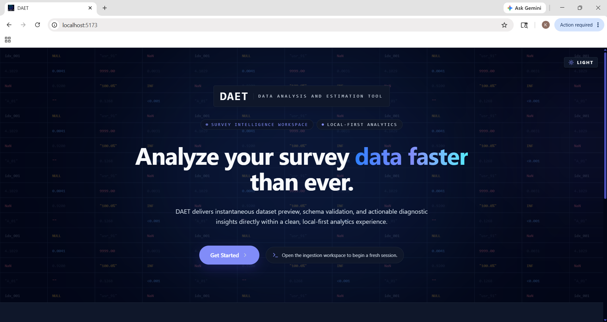
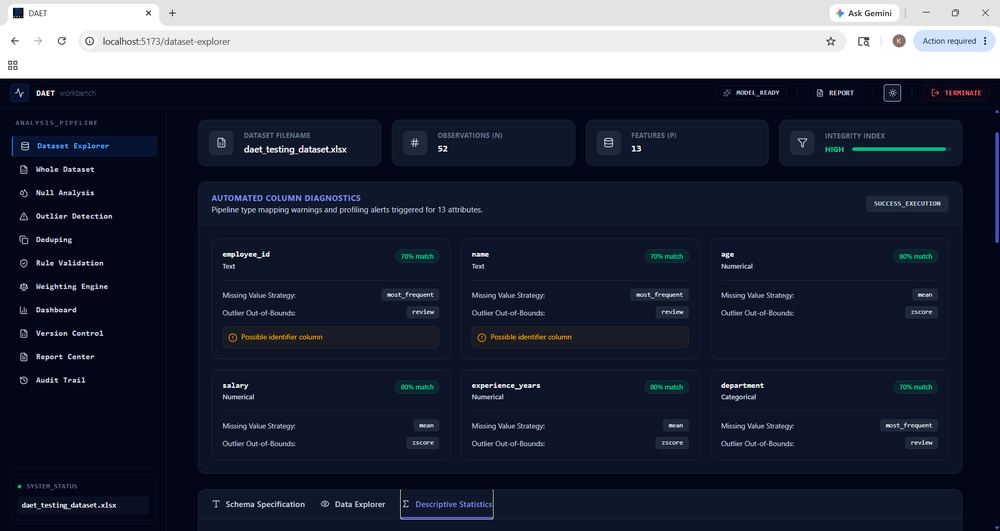
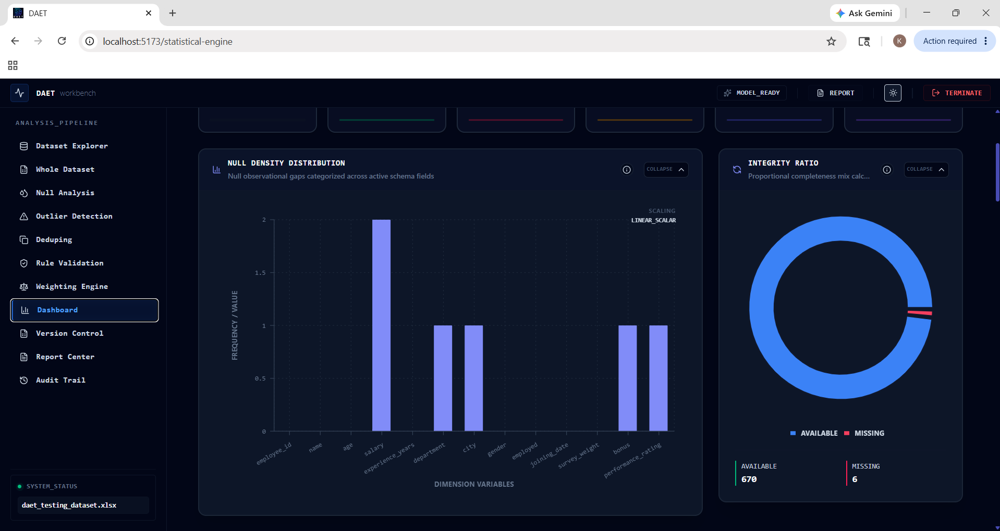
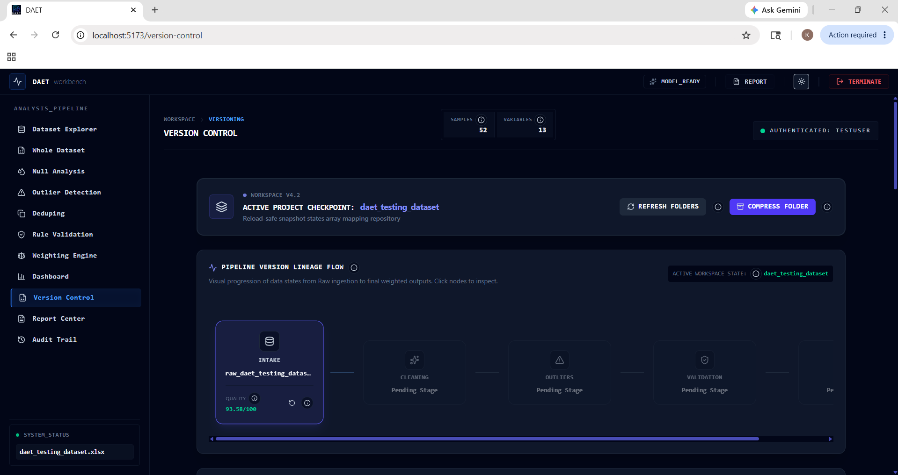

# DAET Frontend (Data Analysis & Estimation Tool)

[](https://react.dev/)
[](https://vitejs.dev/)
[](https://tailwindcss.com/)
[](https://reactrouter.com/)
[](https://playwright.dev/)

DAET Frontend is a modern, responsive React 19 analytics dashboard built for statistical researchers and data analysts. It provides an intuitive, high-velocity interface for survey dataset ingestion, profiling, multi-method cleaning, demographic calibration, version control lineage tracking, and AI-powered data quality explanations.

---

## 📑 Table of Contents

- [Key Features](#-key-features)
- [Application Views & Screenshots](#-application-views--screenshots)
- [Tech Stack Overview](#-tech-stack-overview)
- [Directory Architecture](#-directory-architecture)
- [Routing Table & Navigation](#-routing-table--navigation)
- [State Management & Contexts](#-state-management--contexts)
- [Theme Engine & Design System](#-theme-engine--design-system)
- [Getting Started](#-getting-started)
- [Build & Code Quality Verification](#-build--code-quality-verification)

---

## ⚡ Key Features

* **Instant File Ingestion:** Drag-and-drop CSV and Excel parsing with immediate structural metadata, memory footprint profiling, and row/column sanity checks.
* **Dual-View Dataset Inspection:**
  * **Interactive Spreadsheet Matrix:** Coordinate-level spreadsheet viewer for deep row/column inspection.
  * **Searchable Data Grid:** Live-filtered table with dynamic pagination, data-type badges, and one-click CSV export.
* **Comprehensive Cleaning Workbenches:**
  * **Null Imputation:** Mean, Median, Mode, Constant fill, and Linear/Polynomial interpolation with before-and-after variance previews.
  * **Outlier Detection:** Interactive threshold configuration using Interquartile Range ($1.5 \times \text{IQR}$) and Z-Score ($\pm 3\sigma$) models.
  * **Record Deduplication:** Multi-column duplicate matching with custom retention policies (*Keep First*, *Keep Last*, *Drop All*).
  * **Cross-Field Validation DSL:** Rule builder for range bounds, regex patterns, and conditional dependencies (`if X > Y then enforce Z`).
  * **Demographic Weighting (IPF):** VisualIterative Proportional Fitting configuration for calibrating sample distributions to target population marginals.
* **Dual-Provider Explainable AI Cards:** Direct display of context-aware recommendations and plain-language anomalies from local Ollama (`phi3`) or Google Gemini 2.0 Flash.
* **Git-like Version DAG & Rollbacks:** Node-based lineage graph (powered by React Flow) illustrating version provenance with instant rollback and differential comparison.
* **Automated Audit Trail & Reports:** Centralized chronological ledger tracking every pipeline operation and generating audit-ready PDF compliance reports.

---

## 🖥️ Application Views & Screenshots

### 1. Landing Portal & Authentication

*Interactive welcome portal with live particle data grid background, feature highlights, and authentication modal.*

### 2. Dataset Explorer & Quality Profiling

*Comprehensive overview display showcasing structural metadata, column diagnostics, and AI-driven quality assessment cards.*

### 3. Statistical Summaries & Analytics Dashboard

*Visual analytics suite including correlation heatmaps, variable distribution histograms, scatter plots, and box plots.*

### 4. Version Control Lineage & Rollback Canvas

*Interactive Directed Acyclic Graph (DAG) visualizing version histories, parent-child snapshot branches, and rollback checkpoints.*

---

## 🛠️ Tech Stack Overview

| Category | Technology | Purpose |
| :--- | :--- | :--- |
| **Framework** | React 19.2 | Core declarative UI utilizing the React Compiler for zero-overhead memoization. |
| **Build Tool** | Vite 8.0 | Instant HMR development server and optimized Rollup/Rolldown production bundler. |
| **Styling** | TailwindCSS v4.3 | Pure CSS-injected utility engine with CSS variable design token architecture. |
| **Routing** | React Router v7.1 | Client-side routing with route guarding, fallback redirection, and URL sync. |
| **Charts** | Recharts 3.8 | Composable SVG visualizations (Bar, Line, Scatter, Pie, Histogram, Boxplot, Heatmap). |
| **Lineage DAGs** | React Flow 11.11 | Interactive node-and-edge graph canvas for version lineage and pipeline steps. |
| **Icons** | Lucide React | High-legibility SVG icon library. |
| **Animations** | Framer Motion 12.38 | Smooth layout transitions, modal drawers, and sidebar micro-interactions. |
| **HTTP Client** | Axios 1.16 | Configured HTTP client with base URL resolution and automated error handling. |
| **E2E Testing** | Playwright 1.60 | Multi-browser automated end-to-end integration and workflow testing. |

---

## 📁 Directory Architecture

```
frontend/src/
├── assets/                          # Static assets and media
├── components/                      # Modular UI component hierarchy
│   ├── auth/                        # Modal login and user authentication
│   │   └── LoginModal.jsx
│   ├── charts/                      # Recharts visualization modules
│   │   ├── BarChartComponent.jsx
│   │   ├── BoxPlotComponent.jsx
│   │   ├── CorrelationHeatmap.jsx
│   │   ├── HistogramChart.jsx
│   │   ├── LineChartComponent.jsx
│   │   ├── PieChartComponent.jsx
│   │   ├── PipelineGraph.jsx
│   │   └── ScatterChartComponent.jsx
│   ├── cleaning/                    # Core transformation panels
│   │   ├── Imputation/              # MissingValueContainer.jsx & MissingValuePanel.jsx
│   │   ├── outlier_detection/       # OutlierContainer.jsx & OutlierPanel.jsx
│   │   ├── rule_validation/         # ValidationContainer.jsx & ValidationPanel.jsx
│   │   └── weight_estimation/       # WeightingContainer.jsx & WeightEstimationPanel.jsx
│   ├── common/                      # Shared design system primitives
│   │   ├── AIInsightCard.jsx        # Smart recommendation & explanation widget
│   │   ├── FilterButtonGroup.jsx    # Segmented controls
│   │   ├── MetricStatCard.jsx       # Micro KPI counters
│   │   ├── SearchInput.jsx          # Live search box
│   │   └── StatusBadge.jsx          # Color-coded state indicators
│   ├── complete_dataset/            # Full spreadsheet spreadsheet view
│   │   └── complete_dataset_viewer.jsx
│   ├── dataset/                     # Profiler widgets
│   │   ├── AttributeProfiler.jsx
│   │   ├── ColumnDiagnosticsGrid.jsx
│   │   ├── ColumnHealthCard.jsx
│   │   ├── DataDictionaryTable.jsx
│   │   ├── DataGridTable.jsx
│   │   ├── DatasetKpiCards.jsx
│   │   └── PipelineActionStrip.jsx
│   ├── UI/                          # Application shell and chrome
│   │   ├── DataGridBackground.jsx   # Animated grid background
│   │   ├── Footer.jsx
│   │   ├── InfoTooltip.jsx          # Floating guidance tooltip
│   │   ├── Loader.jsx
│   │   ├── Navbar.jsx               # Top header with session metadata & theme toggle
│   │   ├── Sidebar.jsx              # Collapsible navigation drawer
│   │   └── graphModal.jsx           # Enlarged graph viewer modal
│   └── (Root Components)            # DuplicateContainer, ReportContainer, TimelineContainer, etc.
│
├── context/                         # Scoped React Context Providers
│   ├── AIContext.jsx                # AI insights cache and streaming state
│   ├── AuthContext.jsx              # User session, JWT tokens, and login status
│   ├── DatasetContext.jsx           # Active dataset buffer, preview data & active tabs
│   ├── ProjectContext.jsx           # Multi-project identifiers and active project id
│   ├── ThemeContext.jsx             # Dark / Light theme persistence
│   └── VersionContext.jsx           # Active snapshot version and history pointers
│
├── hooks/                           # Custom business logic and API polling hooks
│   ├── useAI.js                     # AI recommendation and explanation queries
│   ├── useDataset.js                # Dataset state access and mutation hooks
│   ├── useExport.js                 # Export and tokenized download operations
│   ├── usePipeline.js               # Pipeline progress and stage tracking
│   ├── useReports.js                # PDF report job dispatching and status polling
│   ├── useStatistics.js             # Statistical summaries & correlation computations
│   ├── useValidation.js             # DSL rule execution and failure parsing
│   ├── useVersioning.js             # Version history, diffing, and rollback actions
│   └── useWeighting.js              # IPF raking algorithm dispatching
│
├── pages/                           # Top-level view controllers
│   ├── analysis/StatisticalEngine.jsx
│   ├── cleaning/
│   │   ├── AnomalyDetection.jsx
│   │   ├── AuditTrail.jsx
│   │   ├── Deduping.jsx
│   │   ├── LogicValidation.jsx
│   │   ├── NullAnalysis.jsx
│   │   └── WeightingEngine.jsx
│   ├── data/
│   │   ├── DatasetExplorer.jsx
│   │   └── WholeDatasetPage.jsx
│   ├── home/Mainpage.jsx
│   ├── ingestion/IngestionPage.jsx
│   └── versioning/VersionControl.jsx
│
├── services/api/                    # Axios API client and endpoint service bindings
├── utils/                           # Session restoration, report helpers, tooltips
├── allroutes.jsx                    # Canonical React Router configuration
├── App.jsx                          # Root shell component
└── index.css                        # Design token palette and global CSS variables
```

---

## 🗺️ Routing Table & Navigation

| Route Path | View Component | Description |
| :--- | :--- | :--- |
| `/` | `Mainpage` | Product overview, feature showcases, and getting started landing. |
| `/ingestion` | `IngestionPage` | Drag-and-drop CSV/XLSX file upload and intake portal. |
| `/dataset-explorer` | `DatasetExplorer` | Macro quality scores, column health diagnostics, and profiling. |
| `/whole-dataset` | `WholeDatasetPage` | Dual-mode inspection: full spreadsheet grid and searchable table. |
| `/null-analysis` | `NullAnalysis` | Missing value imputation workbench (Mean, Median, Mode, Interpolate). |
| `/anomaly-detection` | `AnomalyDetection` | Outlier identification using IQR and Z-Score statistical bounds. |
| `/deduping` | `Deduping` | Exact and subset duplicate row matching and deduplication. |
| `/logic-validation` | `LogicValidation` | Business rule and cross-field conditional DSL validator. |
| `/weighting-engine` | `WeightingEngine` | Iterative Proportional Fitting (IPF) demographic sample raking. |
| `/statistical-engine` | `StatisticalEngine` | Correlation matrices, histograms, scatter plots, and box plots. |
| `/version-control` | `VersionControl` | Interactive DAG version lineage, differential comparisons, and rollbacks. |
| `/report-center` | `ReportContainer` | Background PDF report builder and download center. |
| `/audit-trail` | `AuditTrail` | Immutable chronological ledger of all dataset transformations. |

---

## 🧠 State Management & Contexts

DAET utilizes a clean, modular React Context architecture ensuring zero state pollution:

1. **`DatasetContext`**: Manages the currently loaded dataset buffer, metadata, schema definitions, and session restoration via `localStorage`.
2. **`AIContext`**: Tracks AI recommendations, natural language explanations, active model targets, and cached response payloads.
3. **`ThemeContext`**: Manages persistent Light/Dark mode state and synchronizes class tokens to `document.documentElement`.
4. **`VersionContext`**: Stores active snapshot identifiers, available version histories, and lineage diff caches.
5. **`AuthContext`**: Manages authenticated sessions, JWT bearer tokens, and user profile metadata.

---

## 🎨 Theme Engine & Design System

DAET features a high-contrast, accessibility-tested design system with complete Dark and Light theme coverage configured in [`index.css`](file:///c:/Users/kvcsu_ht23nk8/OneDrive/Desktop/all_Projects/Projects/DAET/frontend/src/index.css):

* **Dark Theme:** Deep Obsidian (`#020617`), Midnight Slate surfaces (`#0f172a`), crisp Slate borders (`#1e293b`), and Indigo accents (`#818cf8`).
* **Light Theme:** Pure White cards (`#ffffff`), ultra-clean Slate backgrounds (`#f8fafc`), subtle borders (`#e2e8f0`), and deep navy typography.

---

## 🚀 Getting Started

### Prerequisites
* Node.js (v18.0.0 or higher)
* npm (v9.0.0 or higher)

### Setup & Run
```bash
# 1. Enter the frontend directory
cd frontend

# 2. Install all dependencies
npm install

# 3. Start the local development server with Vite HMR
npm run dev
```
The frontend will start at **`http://localhost:5173`**.

---

## 🧪 Build & Code Quality Verification

```bash
# Verify ESLint syntax and code styling rules
npm run lint

# Compile production-ready Vite bundle
npm run build

# Run Playwright automated end-to-end test suite
npx playwright test
```
The production bundle will be generated in `frontend/dist/`.
